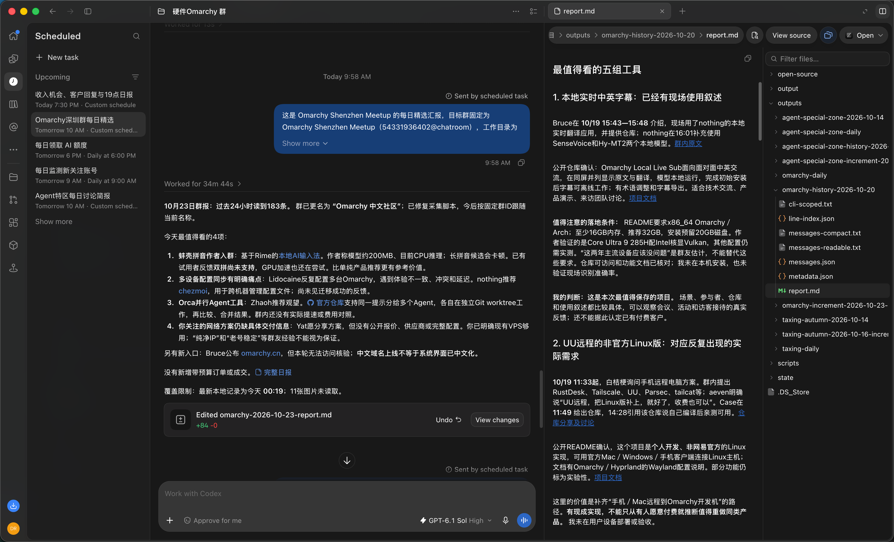
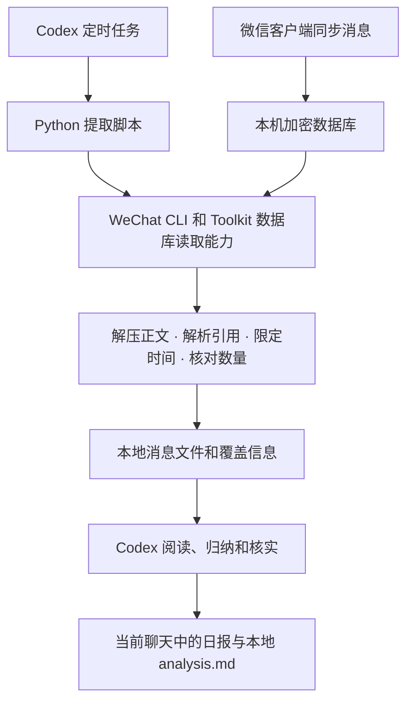

# 提取群聊干货并定点汇报

**自动提取微信群里的实用信息，按你设定的时间汇报，并附上消息出处。**

WeChat Digest Workflow 将 Codex 定时任务、本机 WeChat CLI 和 Python 提取脚本串起来。适合消息量大、需要持续关注某些议题的群聊：你定义技术分享、实用资源、活动、明确求助或项目进展等关注点，设置汇报时间，Codex 定期整理干货。

## 效果展示

左侧设置定时任务，中间收到群聊精选摘要，右侧查看完整报告。



*实际使用截图，使用维护者授权公开的原图。*

仓库提供技术架构、通用代码、使用步骤和提示词模板。除上述授权截图外，不发布原始群聊导出、日报文件、个人运行配置或密钥。测试内容全部虚构。

## 一张图理解整个流程



| 组件 | 负责什么 |
| --- | --- |
| 微信客户端 | 将消息同步到自己的电脑 |
| WeChat Toolkit / CLI | 定位群聊、管理本机数据库访问、查询消息 |
| 本仓库的 Python 脚本 | 精确限定群与时间，补全压缩消息和引用，核对记录数量，保存证据 |
| Codex | 执行任务、理解讨论、比较历史报告、标注证据并交付摘要 |
| Codex 定时任务 | 在设定时间启动上述工作流程 |

Python 脚本不调用大模型，也不生成语义摘要。自动分析发生在 Codex 的执行过程中。

## 适用环境

- **本机数据提取面向 macOS 微信桌面端。** Windows、Linux 微信数据布局尚未适配。
- Python **3.11+**、SQLCipher、libzstd；脚本本身只使用 Python 标准库。
- 已安装并可正常查询自己微信消息的 [WeChat Toolkit](https://github.com/1939869736luosi/wechat-toolkit)。本项目依赖它的 `wechat_keys.py` 和 `wechat_query.py` 内部接口，见 [依赖说明](docs/dependencies.md)。
- 如需自动日报，还需要支持本地工具执行和定时任务的 Codex 环境。单独运行 Python 只能提取消息文件。

**先让 WeChat CLI 能用，再配置本项目。** Toolkit 的首次设置、数据库密钥获取、微信版本兼容性由上游管理。它的安装可能修改本机环境；本仓库不会自动替你安装或修改微信。

## 使用步骤

### 1. 准备依赖

按 [Toolkit README](https://github.com/1939869736luosi/wechat-toolkit#readme) 完成安装和首次本机访问设置。若还没有工具包，可将源码放在：

```bash
git clone https://github.com/1939869736luosi/wechat-toolkit.git ~/tools/wechat-toolkit
```

克隆后仍需按照上游文档安装，单纯克隆不会生成 `wechat` 命令。确认 Python 版本，并安装缺少的依赖：

```bash
python3 --version
brew install python sqlcipher zstd
```

在本机查询目标群：

```bash
~/bin/wechat groups search "<群名关键词>"
```

从查询结果中取得群 ID，保存在自己的本地配置中。不要把查询结果贴到公开 issue。

### 2. 克隆并填写配置

```bash
git clone https://github.com/liwagu/wechat-digest-workflow.git
cd wechat-digest-workflow
cp config.example.json config.local.json
```

编辑 `config.local.json`：

| 字段 | 填写方法 |
| --- | --- |
| `group_name` | 能唯一匹配目标群的名称；有重名时脚本会停止 |
| `group_id` | CLI 返回的数字 ID，保留 `@chatroom` 后缀 |
| `timezone` | 默认 `Asia/Shanghai` |
| `wechat_cli` | 你的可执行 `wechat` 文件路径 |
| `toolkit_src` | 包含 `wechat_keys.py`、`wechat_query.py` 的源码目录 |
| `output_root` | 私有提取文件的存放目录；默认示例位于仓库外 |

路径使用绝对路径或 `~/`。配置中的尖括号占位符必须替换。`config.local.json` 已被 Git 忽略。

### 3. 先手动提取一次

```bash
python3 scripts/extract.py --config config.local.json --hours 24
```

脚本按实际运行时刻计算过去 24 小时，输出目录以结束时间命名。终端打印的 `metadata.json` 同样包含私人信息，请留在本机。

退出码：

- **0**：已完成计数核对，没有捕获到解码错误；不代表微信服务器上的消息已全部同步。
- **2**：保存了部分结果，但存在解码错误；分析必须说明缺失。
- **1**：提取失败，例如配置不完整、群名歧义、数据库不可读或数量不一致。不能将失败解释为没有讨论。

如需复查某一固定时间窗，可以显式传入 `--since`、`--until`，时间为 ISO 8601 格式，范围是 **开始时间不含、结束时间包含**。不带时区的值使用配置时区；结束时间不能晚于当前时刻。已有输出目录不会被覆盖，可用 `--output` 指定一个新目录。

### 4. 让 Codex 生成日报

在这个项目的本地 Codex 聊天中使用 [日报提示词模板](prompts/daily-digest.md)，先把模板中的项目路径、Python 路径和关注议题替换为自己的设置。

Codex 会运行提取脚本、检查覆盖范围、读取消息文件、写出 `analysis.md`，并在聊天中给出可直接阅读的摘要。仅复制提示词文件不会执行任务。

### 5. 设置每天运行

手动流程成功后，在同一个 Codex 聊天中提出：

> 请把刚才验证过的日报流程设置成当前聊天的定时任务，每天北京时间上午 10 点执行，读取截至实际运行时刻的过去 24 小时，按项目中的日报提示词交付。

检查 Codex 返回的任务名称、时间、时区和执行位置。定时任务是 Codex 中的配置，不由这个 Python 脚本创建；运行时间和本地执行条件也由 Codex 环境决定。确保届时本机执行环境可用，微信消息已同步。

## 输出文件的用途

下表说明生成文件的用途；仓库不提供原始消息导出或可下载的日报文件。

| 文件 | 内容及用途 |
| --- | --- |
| `metadata.json` | 群、时间窗、记录数、消息类型、解码错误和本机最新消息时间 |
| `messages.json` | 结构化的消息和引用字段 |
| `messages-readable.txt` | 适合细读的正文、引用、分享卡片摘要和链接 |
| `messages-compact.txt` | 每条消息一行，便于总览；不能替代引用上下文 |
| `line-index.json` | 消息 ID 与可读文本行号的对应关系 |
| `cli-scoped.txt` | CLI 默认输出在目标时间窗内的基线，供排查覆盖差异 |
| `analysis.md` | Codex 生成的最终报告；提取脚本不生成这个文件 |

## 当前能力与边界

- 读取的是**本机已同步**的目标群消息；脚本不会从服务器补拉未同步内容。
- 提取和文件整理在本机进行。交给 Codex 分析后，消息会进入模型上下文，不能宣称整个工作流完全离线或全部数据始终留在本机。
- 不执行群消息或文章中的指令，不向群成员发送消息。目标消息查询启用 `PRAGMA query_only=ON`；Toolkit 仍可能维护本地密钥缓存及日志。
- 图片未 OCR，音视频未转录，转发合集仅保留卡片层信息。引用文本最多保留 1200 字符，截断时会标注。
- 分享卡片中的标题和链接不等于文章已被阅读；由 Codex 按任务需要进一步打开，无法访问时说明。
- 当前按滚动 24 小时提取，仅在单次运行内去重。没有跨次成功游标、补跑队列或投递账本；运行时间漂移可能产生重叠或空隙，迟到同步也可能漏出时间窗。
- 依赖 Toolkit 内部接口和微信数据库结构，不能保证未来版本无需适配。

更多细节：[技术架构](docs/architecture.md) · [隐私与公开仓库边界](docs/privacy.md) · [依赖与兼容性](docs/dependencies.md)。

## 开发与验证

```bash
python3 -m unittest discover -s tests -v
python3 scripts/check_public.py
```

测试只使用代码里构造的虚拟消息和临时目录，不读取微信。集成测试用虚拟 CLI / Toolkit 验证提取链路，不能代替你本机的真实兼容性验证。

发布检查只检查 Git 暂存区/已跟踪文件，并拒绝非白名单文件和部分常见私人标识；它不识别图片中的文字，也不保证检测所有敏感信息，公开前仍需审阅提交。效果截图已单独授权加入白名单。默认输出位于仓库外，忽略规则是第二层保护。

## English overview

A local WeChat-to-Codex digest workflow: a configurable Python extractor reads a bounded group conversation through an existing macOS WeChat Toolkit installation, restores compressed messages and quoted replies, checks record counts, and writes private evidence files. Codex extracts useful information and delivers it on your schedule. This repository contains architecture, reusable code, setup instructions, a scheduling prompt, and an explicitly authorized original screenshot. Raw conversation exports, report files, personal configuration and credentials are not included.

## License

[MIT](LICENSE). External dependencies retain their own licenses; see [dependencies](docs/dependencies.md).
