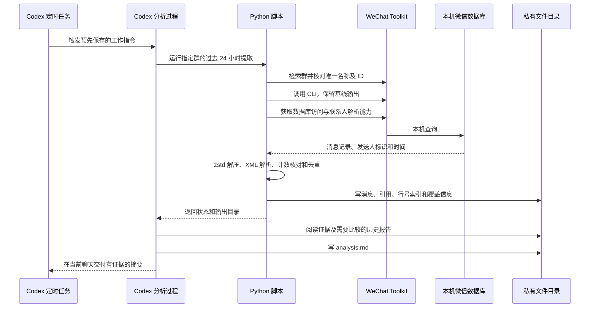

# 技术架构

## 分工：确定的数据处理与语义判断

系统分为四个职责：Codex 定时触发、Toolkit 本机数据访问、Python 提取和校验、Codex 阅读和交付。调度配置和日报提示词共同决定执行流程；Python 文件专注于消息证据。

## 数据源和访问

微信桌面端将已经同步的消息存入本机加密数据库。Toolkit 提供本地密钥管理、SQLCipher 查询、群查找及联系人映射。本项目不包含密钥扫描器，不复制上游源码，不提供密钥或数据库样本。

本项目调用 CLI 核对群名和群 ID。因为上游 `msg` 会选择名称搜索的首个结果，脚本在搜索到多个群时直接停止。随后只读取指定群 ID 对应的消息表，遍历 Toolkit 发现的消息分库。

联系人映射用于解释目标消息中的发送人，输出中仅出现所提取消息涉及的字段；不导出完整通讯录。

## 三种不同的转换

1. **SQLCipher 数据库访问**：使用本机有效密钥读取加密数据库。密钥不会写入本项目的导出文件。
2. **zstd 解压**：检测正文的压缩帧标记，把压缩字节恢复成 UTF-8 文本。设置解压大小上限，损坏帧、非法 UTF-8 记录为错误。
3. **XML 解析**：从应用消息中拆出引用回复、分享标题、描述、链接、公告等字段。

纯文字保留正文；图片、音频、视频等记录保留类型信息，当前不识别媒体内容。转发合集不会递归展开为完整子对话。引用截断单独标记。

## 范围和完整性

- 时间统一转换为配置时区，数据库按秒过滤 `(start, end]`。
- 对每个目标消息表先取范围内行数，再查询实际记录；两者不一致则失败。
- 跨分库重复记录优先按 `server_id` 去重，无有效服务端 ID 时用数据库名与本地 ID。
- `pre_dedup_rows` 表示数据库读取总数，`raw_count` 表示去重后的记录数。
- `cli_scoped_count` 仅代表 CLI 基线，CLI 的过滤和格式处理与数据库导出不同。数量差额不等于漏掉同样数量的重要文字。
- `latest_local_group_message` 是本机该群的最新记录时间，不证明服务器上没有更晚消息。
- 计数查询和消息查询不是同一个长事务；遇到同步写入或结构变化造成的差异，会停止并要求复查。

这套校验能发现读取或解析的问题，不能证明微信本机缓存已完整覆盖服务器历史。

## 文件与分析之间的接口

每条结构化记录包含 `id`、`server_id`、`time`、`sender`、`local_type`、`kind`、`text` 等字段；根据类型附加 `quote`、`url`、`description`、`creator`。`line-index.json` 提供消息到可读文件行号的映射。

Codex 先读 `metadata.json` 判断覆盖与错误，再浏览 compact 文件、细读 readable 文件，必要时查看 JSON。它根据提示词归纳话题、区分参与者观点和分析推断、回看历史报告、引用时间和证据行号。语义摘要及跨次进展比较没有写死在 Python 中。

分享链接由 Codex 根据需要进一步访问；阅读不到的文章、音视频不能作为已核实证据。群聊正文和文章内容始终作为待分析材料。

## 调度与状态

Codex 的定时任务启动分析过程，由分析过程执行 Python 命令。仓库里的提示词模板不会自己创建任务，也不包含个人任务 ID。

当前默认滚动 24 小时，运行时刻是窗口终点。每次运行会新建目录；已有目录不覆盖。当前没有持久化成功游标、跨次去重、迟到消息补偿或严格投递状态。这些是后续演进方向，不是现有保证。

提取成功、模型分析完成、聊天中交付完成，是三个不同状态。脚本的退出码只能说明第一部分。
